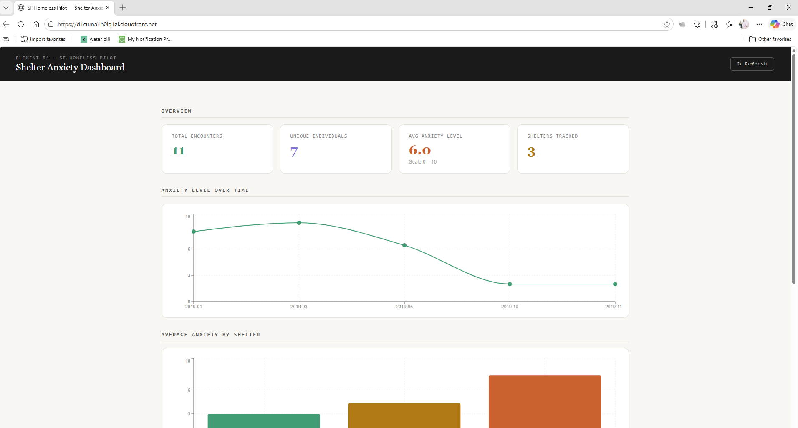

# SF Homeless Data Pipeline — Serverless Data Pipeline & Dashboard

A production-grade serverless data pipeline built on AWS for a government-funded nonprofit addressing homelessness in San Francisco. The system ingests two mismatched government datasets, normalises their incompatible identifier formats, merges them into a unified dataset, and serves the results through a REST API to a live React dashboard.

[](https://github.com/dami-wasabi/SF-Homeless-Data-Pipeline/actions/workflows/ci.yml)

🔗 **Live dashboard:** https://d1cuma1h0iq1zi.cloudfront.net



> **CI** on every push: ruff · mypy · pytest · `tsc` · `cdk synth` · ESLint · Vite build.
> **Deploy** is a manually triggered GitHub Actions workflow (OIDC → CDK deploy → S3 → CloudFront).

---

## The problem

Two datasets describe the same people using the same unique identifier — a Homeless ID (HID) — but each system that generated the files used a completely different format:

| Dataset | Column | Example value | Format |
|---|---|---|---|
| `SF_HOMELESS_DEMOGRAPHICS.csv` | HID | `001-15` | `{seq:03d}-{year}` |
| `SF_HOMELESS_ANXIETY.csv` | Homeless ID | `HM15-1` | `HM{year}-{seq}` |

A naïve join on the raw values produces **zero matches**. The solution is a deterministic key normalisation layer that detects the format at parse time and converts all variants to a single canonical form before any join is attempted.

```
HM15-18  →  strip 'HM'  →  15-18  →  reverse  →  18-15  →  zero-pad  →  018-15
```

Result: **11 merged records, 100% match rate, 0 unmatched encounters.**

---

## Architecture

```
S3 (raw CSVs)
    │
    ├── S3 PUT event ──────────────────────────────┐
    │                                              │
    └── EventBridge rule (02:00 UTC cron) ──────── Lambda ETL
                                                   │  normalize HID
                                                   │  join datasets
                                                   │  validate output
                                                   ▼
                                               DynamoDB
                                           (merged records)
                                                   │
                                               API Gateway
                                             (HTTP API v2)
                                                   │
                                           CloudFront + S3
                                           (React dashboard)
```

**Every service is pay-per-use. Idle cost = $0. Total pilot cost < $1/month.**

---

## Running the tests

No AWS credentials required. Tests complete in under 1 second.

```bash
git clone https://github.com/dami-wasabi/SF-Homeless-Data-Pipeline.git
cd SF-Homeless-Data-Pipeline
pip install -r requirements.txt
python -m pytest tests/ -v
```

**31 tests covering:**
- HID normalisation — 8 cases (single/double/triple digit, case-insensitive, whitespace, invalid format)
- Demographics CSV parsing — 5 cases
- Anxiety CSV parsing — 4 cases
- Merge / join logic — 6 cases
- Record serialisation — 2 cases
- Full integration against the real CSV files — 4 cases
- DynamoDB scan pagination and result limits (mocked table) — 2 cases

---

## Project structure

```
SF-Homeless-Data-Pipeline/
├── .github/workflows/
│   ├── ci.yml            # lint, type-check, test, synth, build on every push
│   └── deploy.yml        # manual OIDC deploy: CDK → S3 → CloudFront
├── etl/
│   ├── transform.py      # HID normalisation, CSV parsing, join logic
│   ├── s3_sync.py        # S3 download + change-detection via SSM
│   └── storage.py        # DynamoDB read/write layer
├── lambda/
│   ├── etl_handler.py    # ETL Lambda — S3 trigger + EventBridge scheduler
│   ├── api_handler.py    # API Gateway Lambda — REST endpoints
│   └── local_dev.py      # FastAPI dev server for local development
├── tests/
│   └── test_pipeline.py  # 31 unit + integration tests
├── infra/
│   ├── bin/app.ts         # CDK app entrypoint
│   └── lib/e84-pilot-stack.ts  # All AWS resources as code
├── dashboard/
│   └── src/App.jsx        # React dashboard — KPIs, charts, encounter table
└── data/
    ├── SF_HOMELESS_DEMOGRAPHICS.csv
    └── SF_HOMELESS_ANXIETY.csv
```

---

## API endpoints

Base URL: `https://YOUR_API_ID.execute-api.us-east-1.amazonaws.com`

| Method | Path | Description |
|---|---|---|
| `GET` | `/summary` | KPI stats — total encounters, avg anxiety, by-shelter breakdown, monthly trend |
| `GET` | `/encounters` | All encounter records (default 100, max 500) |
| `GET` | `/encounters/{hid}` | All encounters for one person by canonical HID |
| `GET` | `/shelters` | List of distinct shelter names |
| `GET` | `/shelters/{shelter}/encounters` | Encounters at one shelter, optional `?from_date=&to_date=` |

---

## Dashboard

The React dashboard is built with Vite and Recharts, deployed to S3 and served globally via CloudFront.

**Features:**
- KPI cards — total encounters, unique individuals, average anxiety level, shelters tracked
- Line chart — anxiety level trend over time (monthly)
- Bar chart — average anxiety by shelter
- Searchable, sortable encounter table with anxiety level colour coding
- Shelter filter dropdown

**Key finding from the data:** Have Hope Shelter shows an average anxiety level of 7.83 compared to 3.80 at Billy's Shelter — the headline insight the dashboard is built to surface.

---

## Deploying your own instance

### Prerequisites

- AWS account with admin access
- Node.js 20+ and Python 3.12+
- AWS CLI configured (`aws configure`)

### 1 — Install CDK

```bash
npm install -g aws-cdk
```

### 2 — Bootstrap CDK (first time only per account/region)

```bash
cd infra
npm install
npx cdk bootstrap aws://YOUR_ACCOUNT_ID/us-east-1
```

### 3 — Deploy all infrastructure

```bash
ALERT_EMAIL=you@example.com \
PARTNER_BUCKET=your-partner-bucket-name \
PARTNER_KEY=data/partner_dataset.csv \
npx cdk deploy
```

CDK will output the resources it created:

```
Outputs:
E84PilotStack.ApiEndpoint        = https://xxxxxxxxx.execute-api.us-east-1.amazonaws.com
E84PilotStack.CloudFrontUrl      = https://xxxxxxxxx.cloudfront.net
E84PilotStack.DataBucketName     = e84-pilot-data-ACCOUNT-REGION
E84PilotStack.FrontendBucketName = e84-pilot-frontend-ACCOUNT-REGION
```

### 4 — Upload the CSV files to trigger the first ETL run

```bash
aws s3 cp data/SF_HOMELESS_DEMOGRAPHICS.csv \
    s3://e84-pilot-data-ACCOUNT-REGION/raw/SF_HOMELESS_DEMOGRAPHICS.csv

aws s3 cp data/SF_HOMELESS_ANXIETY.csv \
    s3://e84-pilot-data-ACCOUNT-REGION/raw/SF_HOMELESS_ANXIETY.csv
```

The S3 PUT event fires the ETL Lambda automatically. DynamoDB will have 11 merged records within seconds.

### 5 — Build and deploy the React dashboard

```bash
cd dashboard
npm install
VITE_API_URL=https://YOUR_API_ID.execute-api.us-east-1.amazonaws.com npm run build

aws s3 sync build/ s3://e84-pilot-frontend-ACCOUNT-REGION/ --delete
aws cloudfront create-invalidation --distribution-id YOUR_DIST_ID --paths "/*"
```

---

## CI/CD pipeline

**CI — [`ci.yml`](.github/workflows/ci.yml)** runs on every push and pull request, with no AWS credentials:

| Job | Checks |
|---|---|
| **Python** | `ruff` lint · `mypy` type-check · `pytest` (results uploaded as an artifact) |
| **Infra** | `tsc --noEmit` · `cdk synth`, which renders the full CloudFormation template offline |
| **Dashboard** | ESLint (zero warnings allowed) · production Vite build |

**Deploy — [`deploy.yml`](.github/workflows/deploy.yml)** is triggered manually from the Actions tab rather than on every merge, so infrastructure changes are applied deliberately. It authenticates with **GitHub OIDC** (short-lived credentials, no stored AWS keys), runs `cdk diff` then `cdk deploy`, builds the dashboard, syncs it to S3 with long-lived caching for hashed assets, and invalidates `index.html` in CloudFront.

CDK bootstrap and the OIDC role are one-time setup steps done outside CI, so the pipeline never needs admin-level permissions. Secrets required by the deploy workflow:

| Secret | Value |
|---|---|
| `AWS_ROLE_ARN` | IAM role with an OIDC trust policy for this repository |
| `AWS_REGION` | e.g. `us-east-1` |
| `ALERT_EMAIL` | Email subscribed to the CloudWatch alarm topic |
| `PARTNER_BUCKET` / `PARTNER_KEY` | Partner S3 bucket and CSV key |
| `VITE_API_URL` | API Gateway URL (CDK output `ApiEndpoint`) |
| `FRONTEND_BUCKET` | Dashboard bucket (CDK output `FrontendBucketName`) |
| `CLOUDFRONT_DIST_ID` | CloudFront distribution ID |

---

## Infrastructure cost

| Service | Monthly cost (pilot) |
|---|---|
| Lambda (ETL + API) | < $0.01 |
| DynamoDB (on-demand) | < $0.01 |
| API Gateway HTTP API | < $0.01 |
| S3 (data + frontend) | < $0.01 |
| CloudFront | < $0.10 |
| EventBridge rule | < $0.01 |
| SSM Parameter Store | $0.00 |
| CloudWatch + SNS | < $0.50 |
| **Total** | **< $1.00 / month** |

Scales to approximately $50/month at 1,000 active users per day.

---

## Partner S3 sync

The system checks a partner public S3 bucket nightly at 02:00 UTC via a scheduled EventBridge rule. The ETL Lambda calls `s3.head_object()` on the known file key and compares the `LastModified` timestamp against the last successful run time stored in SSM Parameter Store.

- **If unchanged:** Lambda exits immediately. Cost ≈ $0.000006 per night.
- **If changed:** Full ETL pipeline runs, DynamoDB is updated, SSM timestamp is refreshed.

---

## Monitoring

**In pilot scope:**
- CloudWatch Logs on both Lambda functions (30-day retention)
- ETL error alarm — any Lambda error → SNS → email
- API error alarm — ≥5 errors in 5 minutes → SNS → email
- X-Ray active tracing on both Lambdas
- CloudWatch operational dashboard

**Next step:** publish the HID match rate as a custom CloudWatch metric and alarm if it drops below 95%. A silent drop in matches is the most likely way this pipeline would fail quietly if an upstream system changes its ID format.

---

## Local development

To run the full stack locally without AWS credentials:

**Terminal 1 — API server**
```bash
pip install uvicorn fastapi
uvicorn lambda.local_dev:app --port 3001 --reload
```

**Terminal 2 — React dashboard**
```bash
cd dashboard
npm install
npm run start
```

Open `http://localhost:3000`. The local server reads directly from the CSV files in `data/` and monkey-patches the DynamoDB storage layer — no AWS account needed.

---

## Tech stack

**Backend:** Python 3.12 · boto3 · AWS Lambda · DynamoDB · API Gateway HTTP API v2

**Infrastructure:** AWS CDK (TypeScript) · S3 · CloudFront · EventBridge · SSM Parameter Store · CloudWatch · SNS

**Frontend:** React 18 · Vite · Recharts

**CI/CD:** GitHub Actions · OIDC authentication · pytest · ruff · mypy · ESLint · cdk synth

---

## Environment variables

Copy `.env.example` to `.env` and fill in your values for local development.

```bash
cp .env.example .env
```

| Variable | Description |
|---|---|
| `INTERNAL_BUCKET` | Your data S3 bucket name |
| `DEMOGRAPHICS_KEY` | S3 key for demographics CSV |
| `ANXIETY_KEY` | S3 key for anxiety CSV |
| `PARTNER_BUCKET` | Partner public S3 bucket name |
| `PARTNER_KEY` | Partner CSV S3 key |
| `DYNAMODB_TABLE` | DynamoDB table name |
| `ALERT_EMAIL` | Email for CloudWatch alarm notifications |
